# Cosmos Collection

A personal astrophotography catalog and session planning tools for organizing and exploring your celestial images.

**[Download the latest release](https://github.com/quake101/CosmosCollection/releases)** for Windows, macOS or Linux.

## Features

**Catalog**
- **Image Catalog**: Organize your astrophotography images by object, with equipment, integration time, dates and notes.
- **Image Gallery & Viewer**: Browse all your images with filters; view them with plate-solved annotations.
- **Collage Builder**: Arrange your images on a canvas, or start from suggestions like a Messier poster.
- **Plate Solving**: Solve your images with ASTAP or astrometry.net to show annotations in the viewer and collages.

**Planning**
- **DSO Detail**: Everything about an object in one place: your images, visibility, and links to the other tools.
- **Best DSO Tonight**: The best objects visible from your location tonight, with the Moon's phase and distance.
- **DSO Visibility Calculator**: When an object is best placed, with support for your custom horizon.
- **DSO Target List**: Keep a list of all the targets you wish to image/observe, with duplicate checks.
- **FOV Simulator**: Frame targets with your telescope and camera, including mosaics, rotation and a night-sky view.
- **Weather Forecast**: 7-day forecast with an astro score, and hourly details per day.
- **Locations & Equipment**: Save several observing locations (pick them on a map) with custom horizons imported from NINA or Stellarium, and your telescopes, cameras, eyepieces and barlows/reducers.

**Imaging**
- **Session Manager**: Drop a night's files to create or update sessions, plan them on a calendar with weather and visibility, save mosaic panels and track their progress, and hand them to Siril or PixInsight for stacking.
- **Light Quality Review**: Grade a session's light frames with graphs, grouped by night.
- **NINA Integration**: A live dashboard, plus sending targets, panels and slews to NINA.

*Also: FITS and XISF support, SIMBAD lookup for objects not in the catalogs, finding moved images, backup & restore, themes, a system tray with the weather, automatic updates and a [command line interface](docs/CLI.md).*

## Screenshots

<table>
  <tr>
    <td align="center"><a href="screenshots/DSO-Detail.jpg">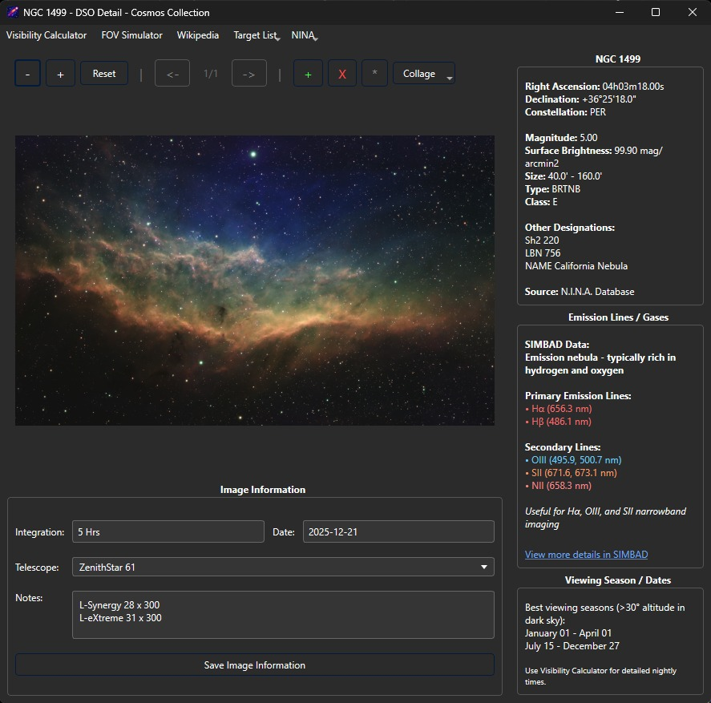</a><br>DSO Detail</td>
    <td align="center"><a href="screenshots/Best-DSO-Tonight.jpg">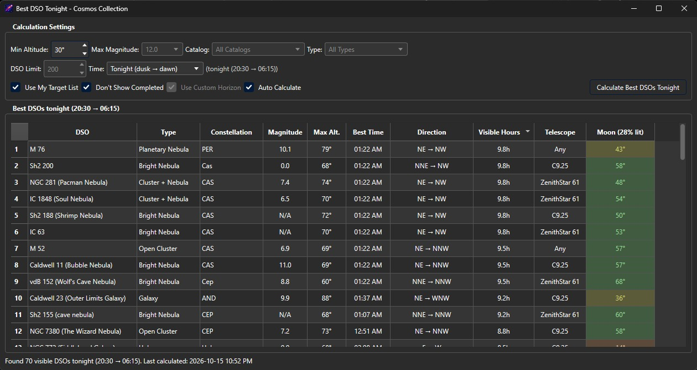</a><br>Best DSO Tonight</td>
  </tr>
  <tr>
    <td align="center"><a href="screenshots/DSO-Visibility-Calculator.jpg">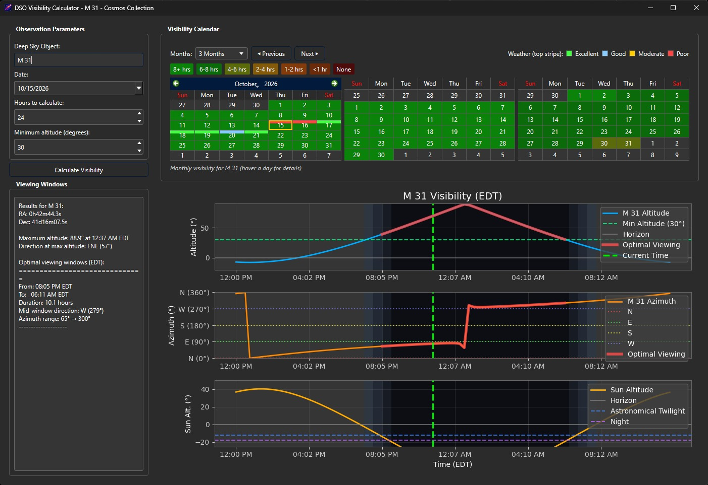</a><br>DSO Visibility Calculator</td>
    <td align="center"><a href="screenshots/DSO-Target-List.jpg">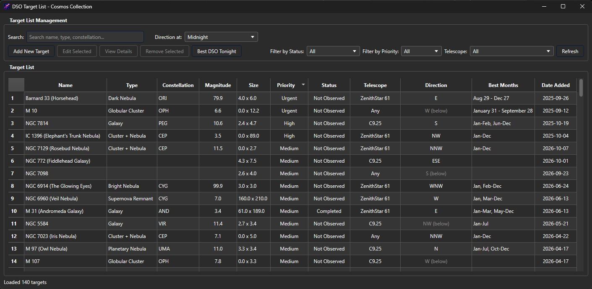</a><br>DSO Target List</td>
  </tr>
  <tr>
    <td align="center"><a href="screenshots/Aladin-Lite-Telescope-FOV.jpg">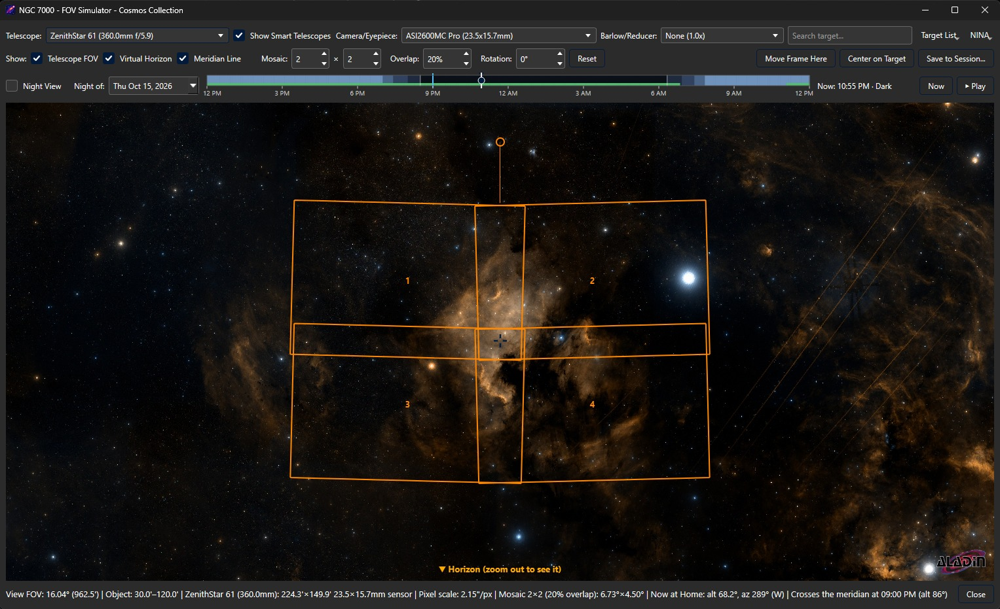</a><br>FOV Simulator</td>
    <td align="center"><a href="screenshots/DSO-Image-Gallery.jpg">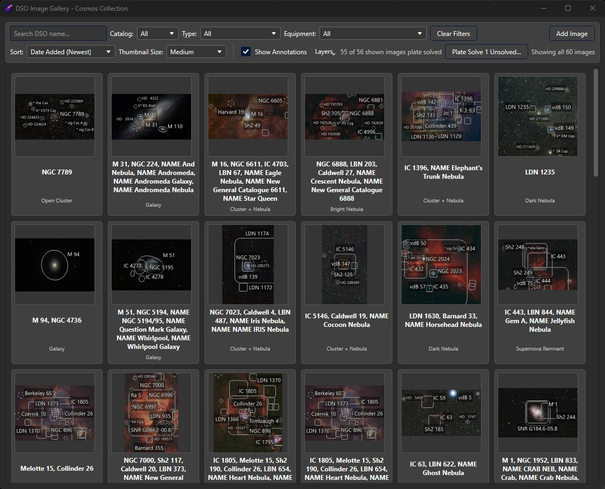</a><br>Image Gallery</td>
  </tr>
  <tr>
    <td align="center"><a href="screenshots/Image-Viewer.jpg">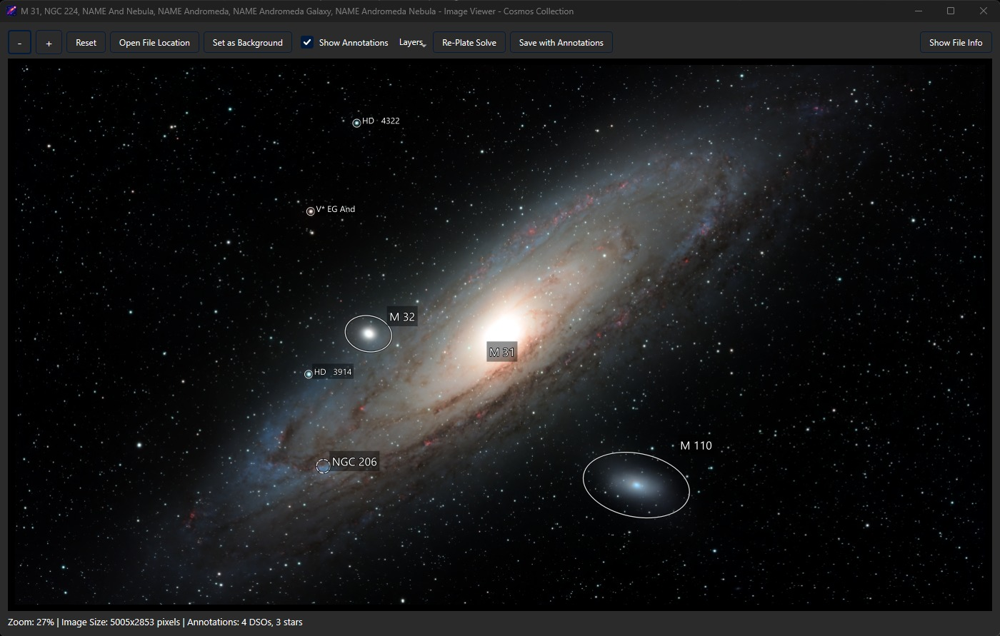</a><br>Image Viewer</td>
    <td align="center"><a href="screenshots/Session-Manager.jpg">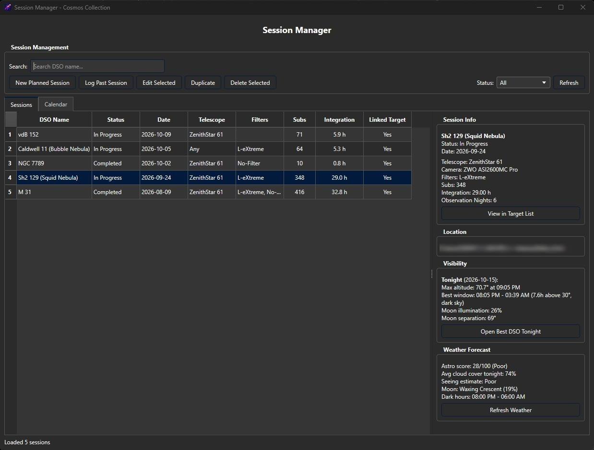</a><br>Session Manager</td>
  </tr>
  <tr>
    <td align="center"><a href="screenshots/Light-Frame-Quality-Review.jpg">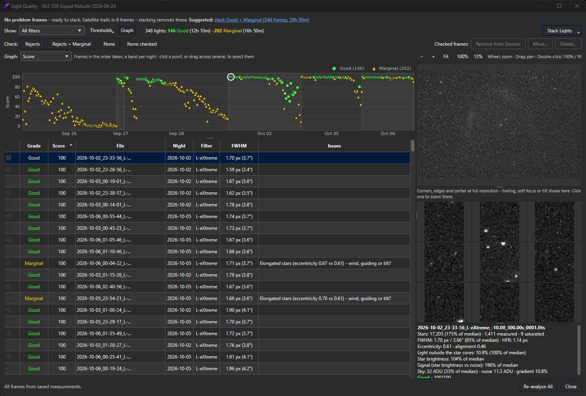</a><br>Light Quality Review</td>
    <td align="center"><a href="screenshots/NINA-Dashboard.jpg">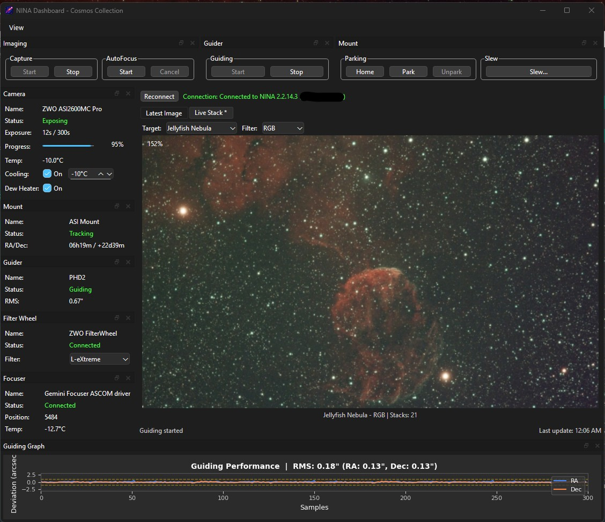</a><br>NINA Dashboard</td>
  </tr>
  <tr>
    <td align="center"><a href="screenshots/Weather-Overview.jpg">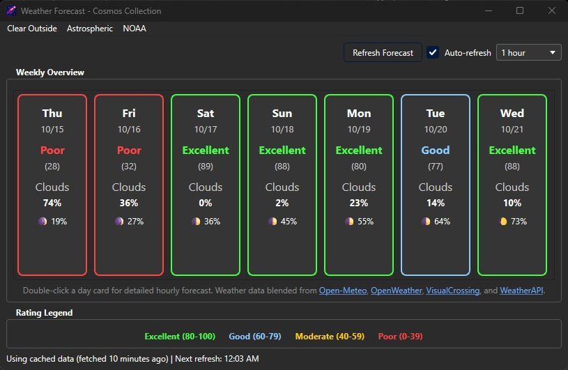</a><br>Weather Overview</td>
    <td align="center"><a href="screenshots/Weather-Details.jpg">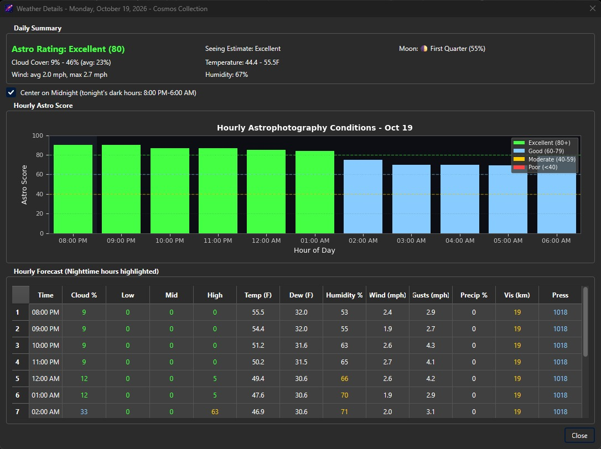</a><br>Weather Details</td>
  </tr>
</table>

## Getting Started

1. Download the zip for your system from the [Releases](https://github.com/quake101/CosmosCollection/releases) page: `CosmosCollection-Windows.zip`, `CosmosCollection-macOS.zip` or `CosmosCollection-Linux.zip`.
2. Extract it and run the application.
3. In **Settings**, add your observing location. The planning tools use it for what's visible and when.
4. Add your telescopes and cameras, then add your images to their objects.

The app checks for updates and can install them for you.

<details>
<summary><b>macOS: first launch</b></summary>

The app is ad-hoc signed but not notarized, so macOS flags it as being from an unidentified developer the first time. Right-click (or Control-click) `CosmosCollection.app`, choose **Open**, and confirm. You only need to do this once.

If macOS still won't open it, clear the quarantine flag from Terminal:
```bash
xattr -cr /path/to/CosmosCollection.app
```
</details>

<details>
<summary><b>Linux: required system libraries</b></summary>

Install the Qt cursor library once before the first run:

```bash
# Ubuntu/Debian
sudo apt-get install libxcb-cursor0

# Fedora/RHEL
sudo dnf install xcb-util-cursor

# Arch Linux
sudo pacman -S xcb-util-cursor
```

**CachyOS / Arch: Map Picker or FOV Simulator won't open.** These use QtWebEngine, which needs the older `libxml2.so.2`. If you see `libxml2.so.2: cannot open shared object file`, install the compatibility package:
```bash
sudo pacman -S libxml2-legacy
```
</details>

## More

- [Building from source](docs/BUILDING.md)
- [Command line interface](docs/CLI.md): add images and search objects from scripts

## Contributing

This is a personal project, developed as a rolling release. Contributions are welcome or feel free to fork it and adapt it for your own use. Not a delevoper, submit your feedback and/or idea as an [issue](issues).

## License

MIT. See [LICENSE](LICENSE).
